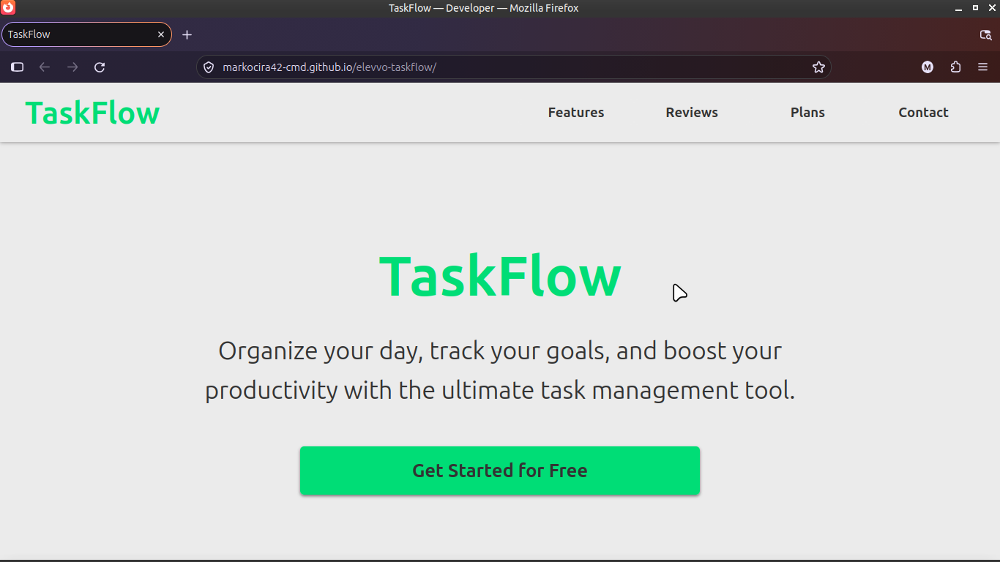
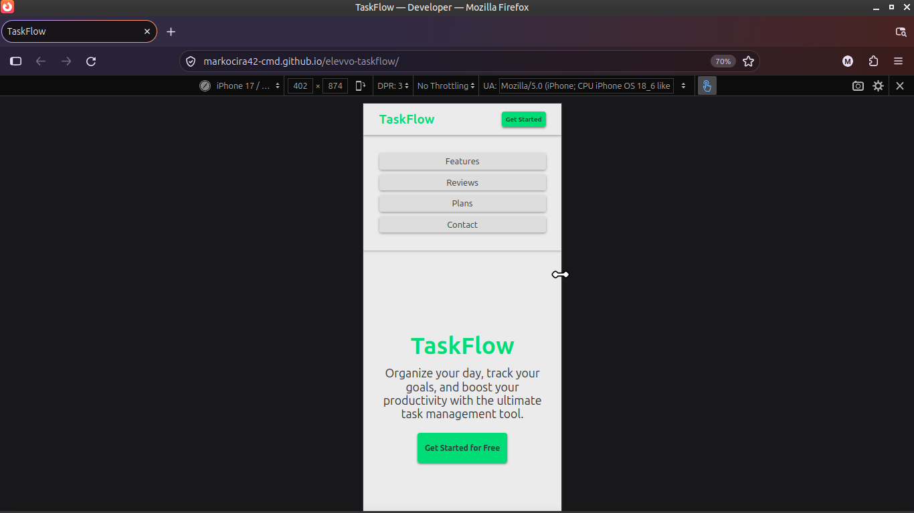

# Elevvo Task 3: TaskFlow Landing Page

A fully responsive, modern landing page for a fictional SaaS product (TaskFlow). Built from scratch as part of the Elevvo Pathways Frontend Internship.

## Live Demo
[View the live site here](https://markocira42-cmd.github.io/elevvo-taskflow/)

## Key Features
- **Modern UI/UX:** Features a clean, SaaS-style design using a 60-30-10 color system and generous spacing.
- **Fluid Typography:** Utilizes CSS `clamp()` for responsive text scaling across all devices without the need for excessive media queries.
- **Responsive Layouts:** Employs CSS Grid for the Features, Testimonials, and Pricing sections, and Flexbox for the header and navigation.
- **Smooth Scrolling:** Native CSS `scroll-behavior` for seamless anchor link navigation.
- **Interactive Elements:** Custom hover states on cards and buttons, plus a dynamic "Back to Top" button that appears on scroll.

## Tech Stack
- **HTML5:** Semantic markup and accessible anchor links.
- **CSS3:** Custom variables (`:root`), CSS Grid, Flexbox, media queries, and transitions.
- **Vanilla JavaScript:** Scroll event listener to toggle the visibility of the "Back to Top" button.

## Architecture & Best Practices
- **DRY Principle:** Shared card styles were consolidated into a single CSS rule block to keep the stylesheet clean and maintainable.
- **Mobile-First Design:** Built from the ground up for mobile devices, scaling up to desktop using a single `min-width: 768px` media query.

## Screenshots

### Desktop View

### Mobile View

